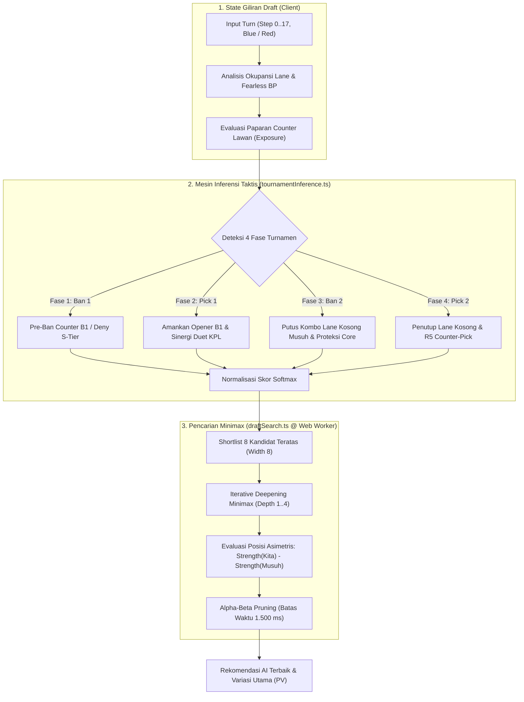

# HoK Draft Engine

Simulator draft, latihan melawan AI, analisis game plan pasca-draft, counter lookup, dan wiki hero **Honor of Kings Global**. Frontend React/TypeScript berjalan pada static hosting; keputusan draft dihitung di browser pengguna.

## Cara kerja mesin draft

Sistem ini dirancang dengan pendekatan **zero-server compute di produksi**, menjalankan kalkulasi taktis deterministik dan pencarian Minimax langsung di browser pengguna.

| Bagian | Peran |
|---|---|
| Aturan & Solver Flex Lane ([draftRules.ts](apps/web/src/engine/draftRules.ts)) | Mengunci urutan 18 aksi, validasi Fearless/Global, serta `assignHeroLanes` berbasis lane primer, flex resmi, dan distribusi flex pro KPL. |
| Mesin Taktis TypeScript ([tournamentInference.ts](apps/web/src/engine/tournamentInference.ts)) | Menghitung bobot ranking instan dari 4 fase turnamen, presensi KPL, sinergi duet, okupansi lane fleksibel, dan matriks counter. |
| Pencarian Minimax Web Worker ([draftSearch.ts](apps/web/src/engine/draftSearch.ts)) | Membandingkan pohon keputusan zero-sum kedua tim via Iterative Deepening Minimax (Depth 1..4, Width 8 cabang, batas 1.500 ms). |
| Mesin Game Plan Pasca-Draft ([gamePlan.ts](apps/web/src/engine/gamePlan.ts)) | Menilai matchup 5v5 (konteks Roam 2v2 & swap `<04:00`/re-swap `04:00`), kurva tempo KPL zero-sum, syarat menang/kalah, rute jungle, anti-invade, dan prioritas gank. |
| Pipeline Audit Bukti Skill ([skill_evidence_audit.py](packages/ml-engine/skill_evidence_audit.py)) | Ekstraksi bukti skill resmi dan panduan taktis untuk memvalidasi 29 tag mobilitas, crowd control, dan peran tim. |
| Sinergi & Tempo Empiris KPL ([extract_kpl_synergy.py](packages/ml-engine/extract_kpl_synergy.py)) | Menghitung frekuensi pick B1/R1, ban fase 1/2 tersaring Global, winrate duet, kurva tempo (Early/Mid/Late), dan flex lane (`year >= 2024`) dari 11.141+ game turnamen pro KPL & CN 2019–2026 ([Fire-Phoenixs/kpl-bp-dataset](https://github.com/Fire-Phoenixs/kpl-bp-dataset)). |

### Diagram Arsitektur Alur Keputusan (Decision Pipeline)



### Format Pertandingan: Turnamen & Ranked

Aplikasi mendukung dua format draft kompetitif yang terintegrasi penuh di mode Simulator maupun Latihan vs AI:

#### 1. Format Turnamen Kompetitif (18 Aksi / 4 Fase)
Format standar turnamen resmi KPL / Global:



#### 2. Format Ranked Match (16 Aksi / 2 Fase)
Format ranked publik Diamond+:
- **Fase 1: Blind Ban Simultan (Langkah 0–5):** Masing-masing tim melakukan 3 ban secara tertutup tanpa mengetahui ban lawan. Kedua tim dapat mem-ban hero yang sama (cross-team overlap diizinkan, tetapi dilarang ban ganda di tim yang sama).
- **Fase 2: Pick Bergiliran (Langkah 6–15):** Urutan pick standar: `B1` $\to$ `R1 + R2` $\to$ `B2 + B3` $\to$ `R3 + R4` $\to$ `B4 + B5` $\to$ `R5`. Hero yang di-ban oleh tim mana pun tidak dapat di-pick.

```mermaid
flowchart LR
    subgraph P1["Fase 1: Ban 1 (Langkah 0-3)"]
        B1["Blue Ban 1"] --> R1["Red Ban 1"]
        R1 --> B2["Blue Ban 2"]
        B2 --> R2["Red Ban 2"]
    end

    subgraph P2["Fase 2: Pick 1 (Langkah 4-9)"]
        R2 --> BP1["Blue Pick B1"]
        BP1 --> RP1["Red Pick R1+R2"]
        RP1 --> BP2["Blue Pick B2+B3"]
        BP2 --> RP2["Red Pick R3"]
    end

    subgraph P3["Fase 3: Ban 2 (Langkah 10-13)"]
        RP2 --> RB1["Red Ban 3"]
        RB1 --> BB1["Blue Ban 3"]
        BB1 --> RB2["Red Ban 4"]
        RB2 --> BB2["Blue Ban 4"]
    end

    subgraph P4["Fase 4: Pick 2 (Langkah 14-17)"]
        BB2 --> RP3["Red Pick R4"]
        RP3 --> BP3["Blue Pick B4+B5"]
        BP3 --> RP4["Red Pick R5 (Last Pick)"]
    end
```

### Logika Taktis Kompetitif Utama

1. **Fase Ban 1 (Pre-Ban & Deny First Pick):**
   - **Sisi Blue:** Mengamankan First-Pick B1 (Plan A/B). Blue dilarang mem-ban opener rencananya sendiri, melainkan mem-ban hero hard counter alaminya berdasarkan data pre-ban turnamen KPL.
   - **Sisi Red:** Karena Blue memegang First-Pick B1, Red fokus mem-ban S-Tier opener Blue (*Deny B1 Blue*) atau mengamankan core respon R1+R2 miliknya.
2. **Fase Pick 1 (Opener & Sinergi KPL):**
   - **Filter Anti-Immobile Carry:** Hero carry tanpa skill escape (Luban No.7, Hou Yi, Angela, Daji, Milady) dikenakan penalti keras `-2.0` sampai `-2.5` agar tidak direkomendasikan pada pick pembuka (B1/R1/R2) karena sangat rentan terhadap komposisi dive turnamen.
   - **Sinergi Duet KPL:** Menghitung bonus `synergy_lift` untuk pasangan hero yang memiliki riwayat $\ge 20$ match dan winrate $\ge 50\%$ di KPL.
3. **Fase Ban 2 (Break Enemy Combo & Strictly Lane-Aware):**
   - Musuh telah memiliki 3 hero di Fase 1 (menyisakan 2 lane kosong). Mesin menyisir kandidat hero yang *bisa mengisi 2 lane kosong musuh* dan memiliki sinergi tinggi dengan 3 hero musuh yang sudah ada, lalu merekomendasikan ban untuk memutus kombo tersebut sebelum musuh sempat melengkapinya.
   - Penalti keras `-2.40` diberikan jika pengguna mencoba mem-ban hero di lane yang sudah diisi musuh (*anti-wasted ban*).
4. **Fase Pick 2 (Penutup Komposisi & Counter Pick):**
   - Memastikan sisa lane kosong terisi tanpa duplikasi role.
   - Langkah 17 (Red Pick R5) mendapat bobot counter tertinggi (`+0.70`) sebagai *Last Counter-Pick* penutup draft.
5. **Peredam Paparan Counter Musuh (`evaluateEnemyCounterExposure`):**
   - Mencegah algoritma memaksakan rekomendasi hero bersinergi tinggi jika hero tersebut menjadi target empuk musuh:
     - 1 counter musuh: Penalti `-0.55`, bobot sinergi KPL diredam ke **55%**.
     - 2 counter musuh: Penalti `-1.45`, bobot sinergi KPL diredam ke **10%**.
     - 3+ counter musuh: Penalti `-2.60+`, bobot sinergi KPL dipotong menjadi **0%**.
6. **Mekanisme Deny Pick & Pemetaan Flex Dinamis:**
   - Evaluasi Minimax bekerja zero-sum: $\text{Strength}(\text{Kita}) - \text{Strength}(\text{Musuh})$.
   - Ketika AI mengambil hero kunci lawan, nilai tree musuh di masa depan anjlok drastis. Akibatnya, Minimax secara alami memprioritaskan *Deny Pick* jika langkah tersebut memberikan keuntungan posisi ganda (memperkuat tim sendiri sekaligus memotong opsi terbaik lawan).
   - Evaluasi okupansi lane di `PICK_PHASE_1`, `BAN_PHASE_2`, `PICK_PHASE_2`, serta `draftSearch.ts` menggunakan `assignHeroLanes` sehingga hero fleksibel (seperti flex resmi atau flex pro KPL `>= 20` game dengan share `>= 15%`) otomatis menggeser penugasan tim tanpa penalti duplikasi lane palsu.

## Game Plan Pasca-Draft, Winning Condition & Simulator Swap

Setelah 18 aksi draft selesai (baik di mode Simulator maupun di akhir game Latihan vs AI), [`PostDraftGamePlanPanel.tsx`](apps/web/src/components/PostDraftGamePlanPanel.tsx) dan [`gamePlan.ts`](apps/web/src/engine/gamePlan.ts) menyajikan evaluasi taktis pasca-draft dari perspektif **Tim Blue** maupun **Tim Red**:

1. **Peta Lane & Simulator Swap 5v5 (`00:00–04:00` + Re-Swap `04:00`):**
   - Menugaskan 5 hero ke `Clash`, `Jungle`, `Mid`, `Farm`, `Roam` (`primer = 100`, `flex resmi = 40+`, `flex KPL = 20 + share * 10`) dan menandai kartu papan draft (`DraftSimulator.tsx`) dengan lencana `Swap` jika hero digeser dari lane primernya.
   - Evaluasi `Mid` & `Farm` memperhitungkan perlindungan **konteks Roam 2v2** (`TERTOLONG_ROAM`) agar hero solo yang tertahan oleh dukungan Roam tidak dipaksa swap taktis yang merugikan makro.
   - Memisahkan `PRIMARY`, `OFFICIAL_FLEX`, `KPL_PRO_FLEX`, dan `TACTICAL_SWAP`. Usulan swap taktis pra-`04:00` hanya diizinkan antar-laner (`Clash`/`Mid`/`Farm`), sedangkan pertukaran yang melibatkan `Roam` atau `Jungle` ditolak kecuali kedua hero valid flex resmi/KPL (swap manual non-flex memicu penalti makro dan label `SWAP_BERISIKO` plus instruksi re-swap setelah menit `04:00`).
2. **Kurva Tempo KPL (Zero-Sum) & Winning Condition:**
   - Memakai **132** kurva winrate empiris KPL (`>= 15` game valid dengan tiga jendela `Early <15m`, `Mid 15–19m`, `Late >=19m`) dengan fallback `profile_estimate` (`Estimasi Profil (KPL minim)`) untuk hero ber-sampel minim.
   - `relativeShares` menormalisasi pangsa tempo relatif kedua tim langsung dari rata-rata winrate fase tanpa pembulatan ganda sehingga persentase dan bilah split selalu berjumlah **100%**, disertai keterangan rata-rata WR fase hero mentah (heuristik, bukan probabilitas kemenangan terkalibrasi).
   - Merangkum arketipe komposisi, syarat menang/kalah utama, dan checklist item counter ancaman lawan.
3. **Pola Start Jungle, Anti-Invade & Gold-Sharing Pra-04:00:**
   - Menentukan kuadran pembukaan (`Strongside` vs `Weakside`), beralih ke protokol `SAFE_SPLIT_OR_GUARD` (*Split-Map Vertical Trade*) jika trio awal lawan berisiko invasi Lv 1–2, serta menyusun rencana *Gold-Sharing* pra-`04:00`, prioritas gank lane, dan fokus objektif `Tyrant` / `Overlord` pada menit `04:00`.

## Simulator dan latihan

- **Simulator:** pengguna mengendalikan kedua tim dan dapat memilih format pertandingan (**Turnamen** atau **Ranked**), serta mengatur Plan A/B masing-masing.
- **Latihan vs AI:** pilih format (Turnamen/Ranked) dan sisi (Blue/Red); AI menjalankan ban/pick tim lawan secara otomatis. Sisi tetap sepanjang seri, maksimal lima game (Fearless tersedia pada format Turnamen).
- **Filter Roster Hero (Global vs Global + CN):** tombol toggle di header navigasi dapat digunakan di seluruh mode (Simulator, Latihan vs AI, Counter Lookup, dan Wiki). Pengguna dapat memilih untuk fokus hanya pada hero rilis Global atau membuka katalog hero server CN.
- **Bantuan opsional:** rekomendasi, radar, badge peringkat, dan sortir AI (serta indikator lane di papan draft) disembunyikan selama latihan berlangsung bila bantuan nonaktif. Wiki dan statistik hero tetap tersedia.
- **Fearless per tim:** pada format Turnamen dengan opsi Fearless aktif, hero yang sudah dipilih suatu tim pada game sebelumnya terkunci untuk pick tim tersebut. Ban tetap mengikuti ketersediaan pada game aktif.
- **Undo latihan:** kembali ke sebelum keputusan pemain terakhir, termasuk membuang respons AI sesudahnya (termasuk reset override lane swap). Game terdahulu menjadi ulasan setelah game berikutnya dimulai.
- **Evaluasi akhir:** menampilkan komposisi kedua tim, panel `Game Plan & Winning Condition` beserta simulator swap lane interaktif, dan alternatif keputusan; tidak menetapkan pemenang pertandingan.

Aturan bersama berada di `apps/web/src/engine/draftRules.ts`. Aplikasi mendukung dua format: **Turnamen (18 aksi)** dan **Ranked (16 aksi)**. Reset, undo, dan pergantian mode/game membatalkan keputusan AI yang tertunda. Worker tidak menerima Plan A/B pemain.

## Live Draft Advisor (membaca layar BP HoK Global)

**Live Draft Advisor** adalah lapisan computer vision in-browser yang membaca layar draft **Ranked** Honor of Kings Global dari jendela Android yang di-mirror via scrcpy, mengenali potret hero mana yang menempati slot mana, memirror board terdeteksi ke simulator, dan menyarankan pick berikutnya. Seluruhnya berjalan di browser — tanpa server, tanpa Python saat runtime.

**Read-only, tanpa injeksi input.** Advisor tidak pernah mengirim input ke game. Input sintetis (adb/scrcpy) dianggap automation oleh anti-cheat game, sehingga auto-play sepenuhnya di luar scope. UI menyatakan hal ini secara permanen.

### Cara menjalankan

1. Mirror perangkat:
   ```powershell
   # Mirror the phone (scrcpy 5.0.1): borderless, 20:9 client area, always on top
   scrcpy --window-width=1920 --window-height=864 --always-on-top --window-border=less
   ```
   Jangan pakai `--fullscreen` di monitor 16:9 — gambar device akan letterbox, pemeriksaan aspect menolaknya, dan advisor melaporkan mismatch. Jangan juga pass `--max-size`; scrcpy sudah meng-encode di resolusi native perangkat.
2. Jalankan dev server di secure context (`getDisplayMedia` menuntut `https` atau `localhost`):
   ```powershell
   cd apps\web
   npm.cmd run dev        # http://localhost:3000
   ```
3. Buka tab **Draft** → mode **Live Advisor** → **Mulai** → pilih share jendela scrcpy.
4. Periksa overlay: setiap slot digambar sebagai kotak di preview — slot pick garis solid, slot ban dashed, semua berlabel (`B1`…`R5`, `ban B1`…`ban R3`). Operator wajib memastikan kotak jatuh tepat di slot layar.
5. Format draft simulator harus **Ranked** agar tombol "Terapkan ke Simulator" berfungsi; selain itu panel menolak dengan alasan eksplisit.

### Yang ditampilkan panel

- Toggle sisi (side), tombol mulai/henti share layar, preview frame dengan overlay slot, dan status layout (terkalibrasi atau "belum terkalibrasi" selama masa trust berjalan).
- Peringatan cross-check sisi: sisi yang terdeteksi dari layar hanya menghasilkan warning; toggle manual operator tetap otoritatif.
- Board draft terdeteksi, rekomendasi pick berikutnya (dari `runTournamentInference`, jalur yang sama dengan Simulator/Latihan), dan tombol apply-to-simulator via jalur aksi bersama `draftRules.ts`.
- Slot pick hanya dianggap committed saat `locked === true`. Slot yang berisi hero dengan `locked === false` **atau `undefined`** dirender sebagai pra-pilih: outline dashed, palet muted, chip "Pilih Dulu" dan catatan "bisa berubah", dengan aria-label "… pra-pilih, belum terkunci, masih bisa berubah". Memperlakukan `undefined` sebagai belum committed adalah arah yang aman.
- Identitas ban kini sering dapat diidentifikasi (jalur match khusus ban, ambang `banMinScore = 0.72` / `banMinMargin = 0.10`; slot pick tetap 0.55/0.04), tetapi tetap dirender sebagai estimasi: nama italic muted, chip "perkiraan", tanpa badge confidence, aria-label "… (perkiraan, bisa salah)". Identitas ban tidak pernah masuk ke draft state.
- Nota ban di panel memisahkan dua kategori secara eksplisit — `observer.ts` mengekspos `abstainedBans` dan `estimatedBans` di samping `unidentifiedBans` (yang tetap gabungan keduanya dan menjaga semantik replay tidak berubah: ban perkiraan tetap memajukan step dan **tidak pernah masuk posisi**). Nota berbunyi, mis. `4 ban teridentifikasi (perkiraan) · 2 ban tidak teridentifikasi — semua ban tetap di luar posisi draft`, dengan varian semua-abstain `2 ban tidak teridentifikasi — semua ban tetap di luar posisi draft`, varian semua-perkiraan `4 ban teridentifikasi (perkiraan) — semua ban tetap di luar posisi draft`, dan tidak ada yang dirender saat tidak ada ban yang tak terpercaya.

### Hasil terukur

- **Profil terkalibrasi (2800×1260):** 10/10 identitas hero benar pada frame 078; 9/10 pada frame 065 (item ke-10 adalah pre-selection terdokumentasi yang settle dua frame kemudian); **0 pelanggaran duplikat hero di 76 frame** spanning dua draft lengkap; identitas pick **392/760** slot-frame; stabilitas temporal slot pick 88–100% per slot.
- **H.264 / path capture:** pada default scrcpy (H.264, 8 Mbps, native encode) pengenalan **identik dengan baseline raw-PNG** di setiap ukuran jendela yang diuji (native 2800×1260, 1920×864, 1400×630). Deviasi piksel per-slot terburuk ≈ 0.9% dari 255 dengan NCC ≥ 0.985. Degradasi mulai sekitar 1 Mbps (slot ban false-fill) dan identitas pick baru pecah dekat 0.25 Mbps.
- **Scale capture:** akurasi pick identik pada 1.0 / 0.7 / 0.5.
- **Layout otomatis — lattice reguler (perangkat tanpa kalibrasi):** solver kini memuat **satu lattice reguler** ke bukti terdeteksi dan menurunkan setiap slot darinya, menggantikan derivasi per-slot dari bounding box art yang mengukur tile 4–8% terlalu kecil (median tinggi art-bbox 96 px vs tile sebenarnya ~100–104 px). Kandidat di-cluster ke dua kolom tepi; **pitch + fase** baris bersama di-fit dengan RANSAC atas hipotesis gap berpasangan dan di-refine dengan median gap baris terdeteksi bersebelahan; fase dijangkar pada **atas bbox kandidat** (kotak tile yang dirender bersifat top-anchored; pusat art-bbox bias saat art tidak mengisi tile penuh) dengan satu refit pengecualian-outlier; residual diumpankan ke confidence. Setiap slot dalam satu kolom berbagi **tepat satu x**, dan y tiap baris = fase + k·pitch — slot kosong termasuk; jumlah baris didiskover (family 5 sebagai fallback). **Ukuran tile tidak lagi berbasis art-bbox:** prioritas tile placeholder persis (rendering tile milik game, fill ≥ 0.9) pada lattice → median per-sumbu (`source: 'evidence'`); selain itu pitch ter-fit × rasio dimensionless tile÷pitch profil terkalibrasi **147/203** (`source: 'pitch-ratio'`, bebas resolusi); jalur yang diambil dilaporkan di `tileWidthSource` / `tileHeightSource` plus catatan berbahasa Indonesia. **Jumlah strip ban didiskover, bukan diasumsikan:** ikon tiap sisi di-dedup/di-cluster dan pitch uniform 1-D di-fit; jumlah slot ban per sisi berasal dari posisi ikon (tidak pernah di-hardcode). Strip dengan **4 atau 5 ikon** menghasilkan 4 atau 5 slot ban per sisi dengan pitch uniform (teruji); saat deteksi melihat **lebih sedikit** ikon daripada isi strip, jumlah family terkalibrasi (3) dipertahankan sebagai floor, karena murni menghitung akan undercount pada ikon gelap/ter-padlock di ujung yang terlewat — fallback-nya dinyatakan di diagnostik. Jalur sizing art-bbox lama dihapus seluruhnya, bukan dipertahankan sebagai fallback: itulah defek terukurnya, dan jalur bukti-placeholder menjangkau frame yang dulu dilayaninya. Gate sudut ban direlaksasi dari 0.2/0.8 ke 0.32/0.68 agar strip 5-ikon muat secara geometris. Terukur pada **87 frame draft-window, 45 solver-trusted**, replay corpus melalui jalur solver: total pick slot-frame teridentifikasi **279/450 → 308/450** (+29), pelanggaran duplikat **0 → 0**; per slot: s0 12→10 (dua misread OLD pada draft #2 yang membaca "193" di tempat harness terkalibrasi membaca 577, hilang), s1 42→42, s2 31→31, s3 33→33, s4 32→37, s5 45→43 (dua sel kini abstain di tempat OLD membaca 114 yang benar-terkalibrasi), s6 24→28 (termasuk menghapus misread "547"), **s7 13→38 (+25 — slot yang gagal di operator)**, s8 21→20, s9 26→26. Pada capture nyata operator melalui jalur solver: R1 (Haya) **0.5096 → 0.5513 (teridentifikasi)**, B3 (Erin) **0.5309 → 0.6343 (teridentifikasi)**. Angka harness terkalibrasi tidak berubah sama sekali: identitas pick **392/760**, identitas ban **148/222 = 66.7% dengan 0 salah**, **0 pelanggaran duplikat** di 76 frame, frame 078 = 10/10, frame 065 = 9/10.
- **Content rect — pencarian aspect-constrained:** `detectContentRect` tidak lagi bergantung pada band near-black saja. Ketika band scan mengembalikan seluruh surface **dan** tidak ada profil terkalibrasi yang bisa direkonsiliasi dengan aspect whole-surface (deviasi > `PROFILE_ASPECT_TOLERANCE = 0.01`), pencarian content-rect aspect-constrained berjalan: jumlah gradien absolut per-kolom/per-baris, 14 kandidat tepi teratas per sumbu, enumerasi (left,right,top,bottom) dengan jendela aspect yang di-binary-search (±1% dari aspect profil), score = total energi boundary dengan tie-break largest-rect, plus evidence gate yang menuntut setiap tepi terpilih ≥ **2×** energi gradien median sumbunya. Verdict membawa `source`: `'bars' | 'aspect-search' | 'whole-surface'`. Kasus terukur: capture operator (jendela Windows Photos menampilkan frame 2800×1260 pada zoom ~68%) adalah surface **1901×982** yang band chromenya **bertekstur** (toolbar baris 0–60: mean 37.7, std 27.9; status bar bawah 40: mean 48.4, std 34.3) → uji band near-black (mean ≤ 8, std ≤ 4) gagal → seluruh surface menjadi content → aspect 1.936 vs profil 2.222 = deviasi **12.9%** → profil terkalibrasi ditolak → jalur solver mengambil alih dengan rect offset 2–8 px dan undersized 4–8% → pick R1 berskor 0.5096 dan pick B3 berskor 0.5309, keduanya **abstain**, dan observer melaporkan `truncated: true` pada step 7. Setelah perbaikan, pencarian mengembalikan **x=2, y=75, 1898×854** — persis ground truth dari NCC template matching (0.99991) — dengan confidence **0.977**, `source: 'aspect-search'`, dan profil **terkalibrasi** dipakai kembali: R1 = **Haya #521 @ 0.5712** (teridentifikasi), B3 = **Erin #155 @ 0.6920** (teridentifikasi), ban tidak berubah (bR1 Li Xin #507 @ 0.8744, bR2 Xuance #195 @ 0.9320, bR3 Daji #109 abstain, bB1 Dunshan #509 @ 0.8985, bB2 Arke #116 @ 0.8997, bB3 Luna #146 abstain), observer **`truncated: false`, replay step 11**. Kombinasi pemenang hanya mengungguli runner-up **3.6%** (210005 vs 202807 — tepi artwork in-game di kolom 1783); yang mencegah rect salah adalah konjungsi empat syarat: jendela aspect ±1%, gate dominasi 2× gradien median (boundary game nyata terukur 5.9×–24× median; tekstur chrome uniform mentok di ~1.1×), empat tepi panjang dominan, dan tie-break largest-rect. Ketika salah satu syarat gagal, pencarian mengembalikan seluruh surface — tidak pernah menghasilkan crop sampah. **Jalur scrcpy tidak tersentuh:** ketika aspect surface sudah cocok dengan profil, pencarian tidak pernah berjalan.
- **Identitas ban kini bekerja (root cause kegagalan lama terbukti):** ikon ban di-game di-crop melingkar (circle-masked) — potret berada di dalam lingkaran yang sudutnya panel gelap — dan badge padlock menutup ~40% lingkaran; membandingkan representasi itu langsung dengan potret referensi persegi 128×128-lah yang membuat skor tak pernah melewati ambang, bukan resolusi. Jalur ban memakai masked NCC (lingkaran radius 31 ter-centre, minus wilayah padlock x ≥ 0.6, y ≥ 0.5 dari ikon 64×64) terhadap varian referensi bergaya ban per-reference (zoom 1.0–1.6, dx −4…+6, dy −4…+2 — 144 konfigurasi), dua tahap (coarse scan → shortlist 10 → fine grid), melalui sampling plan bilinear precomputed bersama. Ambang ban baru: `banMinScore = 0.72`, `banMinMargin = 0.10` (slot pick tetap 0.55/0.04). Ground truth operator (draft #1): strip merah = Li Xin #507, Xuan Ce #195, Daji #109; strip biru = Dunshan #509, Arke #116, Luna #146. Harness atas kedua jendela draft: **148/222 = 66.7% ban slot-frame benar, 0 identifikasi salah, 74 abstain** — 4 dari 6 ban teridentifikasi di seluruh 37 frame, pada setiap capture scale (1.0 / 0.686 / 0.5). Skor hero-benar ban yang teridentifikasi tidak pernah di bawah **0.834** dengan margin ≥ **0.20**; skor hero-salah tidak pernah di atas **0.640** dengan margin ≤ **0.02**. Dua yang abstain melakukannya dengan aman: **Daji** berskor 0.584–0.631 melawan Kongkong'er #550 di 0.605–0.640, dan **Luna** 0.618–0.670 melawan Xuan Ce dengan margin ≈ 0 — wilayah lingkaran yang terlihat memang ambigu dalam grayscale. False positive lama (ban sisi merah terbaca "Ying" #538 padahal hero-nya Xuan Ce #195) hilang: Xuan Ce kini berskor 0.900–0.923 dengan margin ≥ 0.26. Bukti isolasi hipotesis circle-mask: dengan eksklusi padlock crop yang sama memuncak di 0.83–0.92; tanpanya hanya 0.44–0.65 — padlock mendominasi korelasi, bukan sekadar meng-occlude. Resolusi bukan penyebab: urutan hero-benar-vs-salah identik pada capture scale 1.0 / 0.686 / 0.5 dan skornya bahkan sedikit naik saat di-downscale (smoothing). Setiap identitas ban tetap ditandai `estimated: true` dan dilipat ke jalur soft yang sama persis dengan ban tak teridentifikasi: dihitung dalam `unidentifiedBans`, step tetap maju (ban tetap terjadi — occupancy terverifikasi std), pick tetap diterapkan, dan hero tersebut **tidak pernah masuk posisi** — id ban yang salah tidak akan pernah diam-diam menghapus hero dari pool rekomendasi. Invarian asimetri tidak berubah: PICK tak teridentifikasi tetap memotong replay dengan keras. Biaya: dengan cache match per-slot (slot ban selalu di-cache; slot pick hanya saat locked — pre-selection yang belum terkunci selalu di-match ulang), wall-clock matching per frame turun dari **176.3 ms ke 43.6 ms** dengan **72% panggilan matcher terhindar** (446 → 124 panggilan), dan frame statis steady-state berjalan di **~1.2 ms**; hasil tidak berubah — 0 flip identitas / abstention / `estimated` / `locked` di seluruh 446 verdict (skor bisa goyah paling banyak 0.0011, goyah confidence yang memang sudah ada di jalur fresh-match).
- **Registrasi profil terkalibrasi ke frame live:** kandidat tile dari solver mendeteksi tile yang benar-benar terlihat, di-match one-to-one ke slot pick profil (greedy nearest, gate 0.15 × sisi tile), lalu koreksi di-fit — translasi per-sumbu (L1 median, selalu diizinkan) plus, hanya dengan bukti cukup, skala seragam (deviasi ≤ 5% dan MAD rasio ≤ 0.02) atau skala per-sumbu (split w/h ≥ 0.025 yang jelas, kedua sumbu dalam 5%). Satu robust refit membuang outlier dengan residual > max(2.5 × median, 0.03 × sisi) lalu refit sekali. Guard keras: ≥ 3 pasangan total dan ≥ 2 di satu kolom; translasi ≤ 0.08 × sisi tile (≈ 11.8 px); residual median ≤ 0.06 × sisi; residual pasangan maksimum ≤ 0.12 × sisi. Layout yang benar-benar berbeda bergeser ≥ 0.25 × sisi (≈ 37 px) — tiga kali cap — dan ditangani jalur solver-override. Terukur di corpus: registrasi berlaku pada 65 dari 76 frame (ditolak pada 9 frame sparse/overlay karena "pasangan terlalu sedikit" dan 2 karena "residual terlalu besar"); deviasi pusat per-slot dari tile terlihat membaik dari rerata 5.11 px ke 4.36 px, offender terburuk membaik paling banyak (frame 065 slot 0: 8.1 → 4.0 px; slot 7: 13.3 → 8.0 px; frame 078 slot 0: 8.1 → 4.5 px; slot 7: 13.3 → 8.7 px). **Koreksi hanya diterapkan pada geometri overlay yang dipublikasikan — crop pengenalan tetap memakai rect terkalibrasi.** Ini terukur, bukan asumsi: menerapkan koreksi ke crop justru **meregresi** identitas (frame 078 10/10 → 9/10; frame 065 9/10 → 7/10 dengan translasi rigid; lebih buruk lagi dengan skala). Rect terkalibrasi adalah optimum matcher secara konstruksi — `refine_rect` kalibrator memaksimalkan NCC, jadi optimum matcher memang sengaja offset dari kotak tile yang terlihat; angka identitas harness karena itu tetap tidak berubah struktural. **Dengan kata lain: overlay menunjukkan di mana hero terlihat secara visual; matcher men-crop di mana skornya terbaik; keduanya berbeda beberapa piksel pada tile 147 px dan perbedaannya disengaja.** Registrasi tidak pernah menjadi sumber confidence: hanya berjalan pada jalur terkalibrasi yang sudah resolved dan tidak pernah men-gate trust; saat guard menolak koreksi, geometri terkalibrasi polos yang dipublikasikan — perilaku byte-for-byte seperti sebelumnya.

### Belum terbukti (batasan)

- Jalur live **belum pernah dilatihkan terhadap capture `getDisplayMedia` nyata dari jendela scrcpy**. Uji live pertama mengonfirmasi alur end-to-end dan identitas hero, tetapi jalur capture-nya sendiri baru terverifikasi melalui stand-in ffmpeg H.264 yang terkontrol. Semua pengukuran berasal dari PNG `adb exec-out screencap` yang di-round-trip melalui ffmpeg H.264 sebagai stand-in terkontrol untuk jalur live.
- **Advisor kini mengidentifikasi 4 dari 6 ban pada sesi terukur** (jalur match khusus ban, lihat "Hasil terukur") dan abstain pada sisanya by design, tetapi identitas ban tetap estimasi dan **tidak pernah diterapkan ke draft state** — hero yang di-ban tidak masuk posisi. Arahnya aman: ban yang salah tidak akan pernah diam-diam menghapus hero dari pool rekomendasi, dan ban yang abstain paling banyak menghilangkan satu counter-hint.
- **Tidak ada ground truth identitas untuk draft kedua** di corpus — hanya konsistensi lintas-frame.
- **Cara HoK me-layout ulang pada aspect ratio berbeda tidak diketahui.** Satu-satunya bukti adalah simulasi crop/pad/resize mekanis dari satu frame nyata. Perangkat kedua yang nyata — atau memaksa `adb shell wm size 1080x2340` dan memainkan satu draft — akan menjawabnya.
- Slot L1 (Haya, 521) marginal: skor terkalibrasi 0.560 terhadap threshold 0.55, jadi sering abstain. Kemungkinan art skin.
- Hero splash di tengah, kolom ikon skill, dan strip bawah-tengah **bukan** slot pick dan tidak boleh di-match demikian.
- Reference set hanya mencakup potret base; HoK juga merilis skin (layar VS-loading menyebutnya eksplisit).
- **Verdict content-rect di-cache per ukuran surface.** Memindahkan atau men-zoom gambar di dalam jendela mirror tanpa mengubah ukuran jendela meninggalkan rect basi — ubah ukuran jendela (atau restart share) agar pencarian berjalan lagi.
- **Lattice solver sengaja tidak mereproduksi jitter refinement NCC per-slot** (rect referensi slot 0 setinggi 154 px vs family 147 px), jadi jalur solver mencapai 0.5513 di tempat jalur terkalibrasi mencapai 0.5712 — keduanya teridentifikasi. Diskover jumlah baris tidak bisa melebihi family 5 hari ini; papan hipotetis 6 baris akan berakhir untrusted alih-alih salah ter-layout diam-diam. Jika game suatu saat merilis lebih dari 3 ban per sisi, profil akan membawa 18/20 slot — perubahan bentuk output yang **belum** diadaptasi oleh observer.

Kontrak corpus dan struktur `data/vision-corpus/` (gitignored; hanya `README.md` yang ter-track) dijelaskan di [`data/vision-corpus/README.md`](data/vision-corpus/README.md).

## Sumber dan integritas data

- **Kurohiko:** katalog hero, relasi counter, dan alasan taktis komunitas.
- **HOKFIRE:** statistik, build, arcana, skill, dan referensi matchup.
- **HoKStats:** panduan skill/draft, preset build alternatif, detail item/spell, dan matchup editorial. Data disimpan terpisah dari HOKFIRE/KPL dan tidak otomatis menjadi sinyal ranking sebelum ditinjau.
- **Dataset KPL/CN Pro ([Fire-Phoenixs/kpl-bp-dataset](https://github.com/Fire-Phoenixs/kpl-bp-dataset)):** frekuensi opener, ban, serta sinergi empiris (submodule `data/raw/kpl-bp-dataset`, CC BY-NC 4.0). Data historis CN tidak otomatis mewakili meta Global saat ini.

`hero.counters` berisi hero **yang di-counter oleh hero tersebut**. `hero.countered_by` berisi hero **yang meng-counter hero tersebut**. Arah ini tidak boleh dibalik.

Status rilis ditinjau di `data/mappings/hero_release_status.json`. Hero tanpa status eksplisit belum dapat digunakan. ID 511 tetap menjadi alias tidak aktif untuk **Ata 556**. Hero immobile yang ditandai sebagai opener berisiko tidak masuk rekomendasi B1 atau ban fase pertama.

## Menjalankan aplikasi & setup contributor

Gunakan **Git**, **Node.js 24+**, dan **Python 3.13+** yang dikelola melalui **[`uv`](https://docs.astral.sh/uv/)** (ikuti [`packages/ml-engine/pyproject.toml`](packages/ml-engine/pyproject.toml)).

### Clone & Bootstrap Cepat

Data mentah turnamen berada pada Git submodule [`data/raw/kpl-bp-dataset`](data/raw/kpl-bp-dataset). Untuk contributor penuh maupun frontend-only, lihat panduan lengkap di **[CONTRIBUTING.md](CONTRIBUTING.md)**.

```powershell
# Clone beserta submodule dataset KPL
git clone --recurse-submodules https://github.com/Andndre/hok-draft-engine.git
cd hok-draft-engine

# Atau jika sudah terlanjur clone biasa:
uv run scripts/setup.py --verify

# Contributor UI saja (tanpa perlu Python/uv atau dataset mentah 39.5 MB):
uv run scripts/setup.py --web-only --verify
```

```powershell
cd apps/web
npm.cmd ci
npm.cmd run dev

# Build statis; Vite menyalin isi public secara otomatis
npm.cmd run build
npm.cmd run preview
```

Deploy isi `apps/web/dist/` ke static hosting (atau otomatis ke Hostinger via `.github/workflows/deploy.yml`). Distribusi produksi menyajikan aplikasi statis, dataset versi manifest, dan aset gambar langsung dari origin yang sama (`chunks/` dan `datasets/` immutable). Lihat [`LICENSE`](LICENSE) dan [`NOTICE`](NOTICE) untuk lisensi kode (MIT) serta atribusi dataset turunan KPL (CC BY-NC 4.0).

## Memperbarui hero dan metadata

1. Perbarui sumber hero/statistik/counter dan sinergi di `data/mappings/` melalui pipeline scraper/ekstraktor atau koreksi yang ditinjau.
2. Untuk memperbarui data HoKStats, jalankan importer lokal. Ia membuat coverage report, mencatat sumber/tanggal/patch, dan mengabaikan matchup yang tidak bisa dicocokkan ke katalog hero.

```powershell
cd packages/ml-engine
uv run hokstats_source.py sync

# Tinjau sumber hero, matchup, item, atau spell sebelum dipakai scorer
uv run hokstats_source.py review-guide --hero-id 640 --reviewer "Nama reviewer" --status approved
uv run hokstats_source.py review-matchup --hero-id 640 --relation strong_against --target-id 126 --reviewer "Nama reviewer" --status approved
uv run hokstats_source.py review-catalog --kind item --record-id 1127 --reviewer "Nama reviewer" --status approved

uv run publish_data.py
```

Importer mempertahankan review hanya selama hash sumber cocok. Relasi `strong_against` berarti hero tersebut meng-counter target; `countered_by` berarti hero itu terancam oleh target. Record tanpa bukti tidak dianggap sebagai relasi negatif.

3. Tambahkan atau perbarui status rilis setiap hero pada `hero_release_status.json`. Tinjau kemampuan lane, arah counter, dan mapping Global; pertahankan alias Ata.
4. Bila perlu, audit dan tinjau proposal profil taktis seperti contoh di bawah.
5. Bangun paket data:

```powershell
cd packages/ml-engine
uv run publish_data.py
```

`publish_data.py` menghasilkan manifest schema v2 dan folder `datasets/<versi>/` di `apps/web/public/`. Paket berisi metadata hero, sinergi, status rilis, katalog item, dan katalog spell; semua artefak divalidasi dengan SHA-256 dan disebar secara atomik oleh workflow deploy statis.

Browser memeriksa manifest saat aplikasi dibuka, memvalidasi seluruh artefak, lalu menyimpan satu paket lengkap pada cache IndexedDB `tournament_dataset_v17`. Tidak ada fetch HoKStats atau panggilan API eksternal saat runtime. Jika pembaruan gagal, browser memakai paket valid terakhir atau paket bawaan. Jangan mengedit artefak hasil publikasi secara manual karena checksum akan berubah.

Seri latihan mempertahankan snapshot dataset sampai selesai. Saat memulai seri baru, aplikasi memeriksa pembaruan lagi. Penambahan hero dan perubahan status rilis tidak memerlukan perubahan kode atau whitelist TypeScript.

## Profil taktis dan audit bukti skill lokal

Pipeline taktis memakai **ekstraksi bukti skill deterministik** (`skill_evidence_audit.py` dan `tactical_profiles.py audit-batch`) yang membaca deskripsi skill resmi, role, serta panduan taktis hero secara 100% lokal dan deterministik di komputer pengelola tanpa memerlukan GPU atau layanan eksternal.

### Audit batch hero Global

Untuk mengekstrak bukti skill, mengisi 29 label taktis, dan menghasilkan proposal otomatis untuk 120 hero Global aktif:

```powershell
cd packages/ml-engine

# Audit batch 120 hero Global (auto-approve hero dengan bukti lengkap tanpa ambiguitas)
uv run tactical_profiles.py audit-batch --output-dir ../../data/mappings/tactical_proposals

# Atau audit batch tanpa auto-approve (semua tetap berstatus pending)
uv run tactical_profiles.py audit-batch --output-dir ../../data/mappings/tactical_proposals --no-auto-approve

# Proposal hero tunggal
uv run tactical_profiles.py propose --hero-id 156 --output ../../data/mappings/tactical_proposals/liang.json

# Review manual dan simpan status
uv run tactical_profiles.py review --proposal ../../data/mappings/tactical_proposals/liang.json --reviewer "Nama reviewer" --status approved

# Publikasikan dataset produksi
uv run publish_data.py
```

### Label taktis dan verifikasi bukti

Label mencakup:
- **Mobilitas:** `mobility`, `dash`, `blink`, `leap`, `teleport`
- **Crowd Control:** `suppress`, `cc_taunt`, `cc_knockup`, `cc_knockback`, `cc_pull`, `cc_stun`, `cc_root`, `cc_silence`, `cc_slow`
- **Peran & Utilitas Tim:** `engage`, `disengage`, `frontline`, `peel`, `ally_shield`, `ally_heal`, `ally_move_speed_buff`, `ally_attack_speed_buff`, `ally_damage_buff`, `ally_cleanse`, `ally_cc_immunity`
- **Kerentanan:** `dive_vulnerable`, `kite_vulnerable`, `low_damage`, `weak_early`

Auditor menyaring kata negasi (seperti pasif Yaria yang mengecualikan suppress agar tidak ditandai sebagai `suppress=ya`) dan kontaminasi teks hero antar-sumber. Nilai yang tidak didukung bukti skill resmi tetap `tidak_diketahui`.

Proposal menyimpan sumber resmi, hash konten, dan status review. Publisher hanya menyertakan profil berstatus `approved` dengan SHA-256 hash sumber yang valid; perubahan pada data sumber hero otomatis membatalkan approval lama agar ditinjau ulang. Hero tanpa profil taktis approved tetap menggunakan fallback heuristik role bawaan.

**Fixture offline:** pengujian tanpa evaluasi live dapat memakai `--response-fixture <file.json>` atau `--response-fixtures-dir <dir>` untuk menguji alur pipeline.

## Pengujian dan benchmark

```powershell
cd apps/web
npm.cmd test
npm.cmd run benchmark
npm.cmd run build
```

Pengujian mencakup validasi Global/Fearless, lima game tanpa pengulangan pick per tim, matching lane flex, arah counter Liang, alias Ata, batas waktu pencarian, worker aktual melalui transport Node, pembatalan, hasil kedaluwarsa, kedua sisi pemain, pembaruan/cache paket data, serta suite pasca-draft ([gamePlan.test.mjs](apps/web/tests/gamePlan.test.mjs) dan SSR [ui.test.mjs](apps/web/tests/ui.test.mjs): normalisasi kurva tempo 100%, konteks Roam 2v2, penolakan swap non-flex ke Roam/Jungle, dan rencana anti-invade jungle).

```powershell
cd packages/ml-engine
uv run python -m unittest test_data_pipeline.py test_skill_evidence_audit.py test_hokstats_source.py
uv run export_draft_benchmark.py --cutoff 2024-01-01 --limit 24

cd ../../apps/web
npm.cmd run benchmark -- --historical ../../data/processed/draft_benchmark.json --limit 24 --output ../../data/processed/draft_benchmark_results.json
```

Benchmark membandingkan baseline dengan pencarian pada fixture taktis dan posisi KPL yang dipisahkan berdasarkan tanggal. Statistik KPL untuk benchmark dihitung hanya dari pertandingan sebelum cutoff. Pilihan historis bukan satu-satunya keputusan yang benar; angka agreement bukan estimasi kekuatan atau win rate AI. Metadata role dan statistik publik masih memakai snapshot saat ini, sehingga evaluasi ini bukan backtest meta historis yang lengkap.

Data lokal KPL 2025–2026 memakai 20 aksi. Exporter menyaring pertandingan yang cocok dengan format aplikasi 18 aksi dan roster Global; cutoff default 2024 menyediakan holdout kompatibel. Benchmark tidak mengubah aturan aplikasi menjadi 20 aksi.

### Harness vision (Live Draft Advisor)

```powershell
cd D:\hok-draft-engine\packages\ml-engine
uv run convert_reference_images.py --out C:\Users\Andndre\AppData\Local\Temp\opencode\ref-png
uv run calibrate_vision_regions.py --corpus D:\hok-draft-engine\data\vision-corpus --reference C:\Users\Andndre\AppData\Local\Temp\opencode\ref-png --out D:\hok-draft-engine\apps\web\tests\fixtures\vision\region-profile-2800x1260.json
node D:\hok-draft-engine\apps\web\scripts\evaluate-vision-corpus.mjs --corpus D:\hok-draft-engine\data\vision-corpus --profile D:\hok-draft-engine\apps\web\tests\fixtures\vision\region-profile-2800x1260.json --reference C:\Users\Andndre\AppData\Local\Temp\opencode\ref-png --annotations D:\hok-draft-engine\apps\web\tests\fixtures\vision\annotations.json --ranges "28-78,222-256" --exclude "32-36,50-54"
```

`evaluate-vision-corpus.mjs` mengukur identitas hero per slot terhadap anotasi (`annotations.json`, `hero-identity-ground-truth.json`, `ban-identity-ground-truth.json` — identitas ban draft #1 yang diberikan operator), pelanggaran duplikat hero, dan stabilitas temporal slot pick dengan profil region terkalibrasi. Slot ban di-match dengan `kind: 'ban'` persis seperti jalur live, memakai ambang ban bawaan `HeroMatcher` (`banMinScore = 0.72`, `banMinMargin = 0.10` — hasil pengukuran, bukan selera) dan melaporkan **tabel akurasi ban per-ikon** alih-alih membiarkannya implisit di angka abstensi agregat; pemeriksaan duplikatnya di-scope ke slot pick karena identitas ban adalah estimasi dan tidak boleh menyamar sebagai pelanggaran legalitas pick. `h264-fidelity.mjs` mengukur degradasi H.264 terhadap corpus mentah (shells out ke ffmpeg); `derive-vision-profile.mjs` menurunkan profil layout dengan solver asli. Corpus `data/vision-corpus/` gitignored dan harus di-capture lokal (`capture_vision_corpus.py`) sebelum perintah ini dapat berjalan.

Hasil acuan dengan profil terkalibrasi 2800×1260: 10/10 identitas hero pada frame 078; 9/10 pada frame 065 (pre-selection terdokumentasi yang settle dua frame kemudian); 0 pelanggaran duplikat di 76 frame (identitas pick 392/760 slot-frame); stabilitas temporal slot pick 88–100% per slot; akurasi pick identik pada capture scale 1.0 / 0.7 / 0.5; identitas ban **148/222 = 66.7% ban slot-frame benar, 0 identifikasi salah, 74 abstain** (4 dari 6 ban teridentifikasi di seluruh 37 frame — root cause kegagalan lama: ikon ban circle-masked dengan padlock yang menutup ~40% lingkaran, bukan resolusi). Replay melalui jalur solver (87 frame draft-window, 45 solver-trusted): identitas pick 279/450 → 308/450 dengan 0 pelanggaran duplikat; angka jalur terkalibrasi tidak berubah sama sekali.

Panduan agen berada di [AGENTS.md](AGENTS.md). Navigasi arsitektur dapat dimulai dari [knowledge graph](graphify-out/graph.html). Jalankan `graphify update .` setelah mengubah sumber TypeScript/Python.
