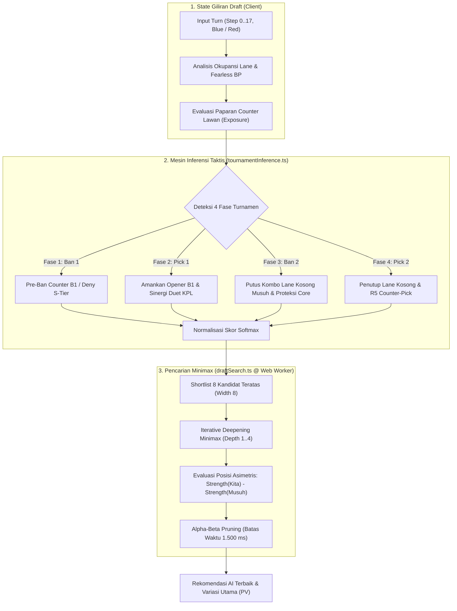

# HoK Draft Engine

Simulator draft, latihan melawan AI, counter lookup, dan wiki hero **Honor of Kings Global**. Frontend React/TypeScript berjalan pada static hosting; keputusan draft dihitung di browser pengguna.

## Cara kerja mesin draft

Sistem ini dirancang dengan pendekatan **zero-server compute di produksi**, menjalankan kalkulasi taktis deterministik dan pencarian Minimax langsung di browser pengguna tanpa dependensi neural/cloud.

| Bagian | Peran |
|---|---|
| Mesin Taktis TypeScript ([tournamentInference.ts](apps/web/src/engine/tournamentInference.ts)) | Menghitung bobot ranking instan dari 4 fase turnamen, presensi KPL, sinergi duet, okupansi lane, dan matriks counter. |
| Pencarian Minimax Web Worker ([draftSearch.ts](apps/web/src/engine/draftSearch.ts)) | Membandingkan pohon keputusan zero-sum kedua tim via Iterative Deepening Minimax (Depth 1..4, Width 8 cabang, batas 1.500 ms). |
| Pipeline Audit Bukti Skill ([skill_evidence_audit.py](packages/ml-engine/skill_evidence_audit.py)) | Ekstraksi bukti skill resmi dan panduan taktis untuk memvalidasi 28 tag mobilitas, crowd control, dan peran tim. |
| Sinergi Empiris KPL ([extract_kpl_synergy.py](packages/ml-engine/extract_kpl_synergy.py)) | Menghitung frekuensi pick B1/R1, ban fase 1/2, dan winrate duet dari 11.141+ pertandingan KPL/KIC 2019–2026. |

### Diagram Arsitektur Alur Keputusan (Decision Pipeline)



### Siklus 18 Aksi Turnamen Kompetitif

Format pertandingan mengikuti standar turnamen resmi KPL / Global:

```mermaid
flowchart LR
    subgraph P1["Fase 1: Ban 1 (Langkah 0-3)"]
        B1["Blue Ban 1"] --> R1["Red Ban 1"]
        R1 --> B2["Blue Ban 2"]
        B2 --> R2["Red Ban 2"]
    end

    subgraph P2["Fase 2: Pick 1 (Langkah 4-9)"]
        R2 --> BP1["Blue Pick B1"]
        BP1 --> RP1["Red Pick R1+R2"]
        RP1 --> BP2["Blue Pick B2+B3"]
        BP2 --> RP2["Red Pick R3"]
    end

    subgraph P3["Fase 3: Ban 2 (Langkah 10-13)"]
        RP2 --> RB1["Red Ban 3"]
        RB1 --> BB1["Blue Ban 3"]
        BB1 --> RB2["Red Ban 4"]
        RB2 --> BB2["Blue Ban 4"]
    end

    subgraph P4["Fase 4: Pick 2 (Langkah 14-17)"]
        BB2 --> RP3["Red Pick R4"]
        RP3 --> BP3["Blue Pick B4+B5"]
        BP3 --> RP4["Red Pick R5 (Last Pick)"]
    end
```



### Logika Taktis Kompetitif Utama

1. **Fase Ban 1 (Pre-Ban & Deny First Pick):**
   - **Sisi Blue:** Mengamankan First-Pick B1 (Plan A/B). Blue dilarang mem-ban opener rencananya sendiri, melainkan mem-ban hero hard counter alaminya berdasarkan data pre-ban turnamen KPL.
   - **Sisi Red:** Karena Blue memegang First-Pick B1, Red fokus mem-ban S-Tier opener Blue (*Deny B1 Blue*) atau mengamankan core respon R1+R2 miliknya.
2. **Fase Pick 1 (Opener & Sinergi KPL):**
   - **Filter Anti-Immobile Carry:** Hero carry tanpa skill escape (Luban No.7, Hou Yi, Angela, Daji, Milady) dikenakan penalti keras `-2.0` sampai `-2.5` agar tidak direkomendasikan pada pick pembuka (B1/R1/R2) karena sangat rentan terhadap komposisi dive turnamen.
   - **Sinergi Duet KPL:** Menghitung bonus `synergy_lift` untuk pasangan hero yang memiliki riwayat $\ge 20$ match dan winrate $\ge 50\%$ di KPL.
3. **Fase Ban 2 (Break Enemy Combo & Strictly Lane-Aware):**
   - Musuh telah memiliki 3 hero di Fase 1 (menyisakan 2 lane kosong). Mesin menyisir kandidat hero yang *bisa mengisi 2 lane kosong musuh* dan memiliki sinergi tinggi dengan 3 hero musuh yang sudah ada, lalu merekomendasikan ban untuk memutus kombo tersebut sebelum musuh sempat melengkapinya.
   - Penalti keras `-2.40` diberikan jika pengguna mencoba mem-ban hero di lane yang sudah diisi musuh (*anti-wasted ban*).
4. **Fase Pick 2 (Penutup Komposisi & Counter Pick):**
   - Memastikan sisa lane kosong terisi tanpa duplikasi role.
   - Langkah 17 (Red Pick R5) mendapat bobot counter tertinggi (`+0.70`) sebagai *Last Counter-Pick* penutup draft.
5. **Peredam Paparan Counter Musuh (`evaluateEnemyCounterExposure`):**
   - Mencegah algoritma memaksakan rekomendasi hero bersinergi tinggi jika hero tersebut menjadi target empuk musuh:
     - 1 counter musuh: Penalti `-0.55`, bobot sinergi KPL diredam ke **55%**.
     - 2 counter musuh: Penalti `-1.45`, bobot sinergi KPL diredam ke **10%**.
     - 3+ counter musuh: Penalti `-2.60+`, bobot sinergi KPL dipotong menjadi **0%**.
6. **Mekanisme Deny Pick di Minimax:**
   - Evaluasi Minimax bekerja zero-sum: $\text{Strength}(\text{Kita}) - \text{Strength}(\text{Musuh})$.
   - Ketika AI mengambil hero kunci lawan, nilai tree musuh di masa depan anjlok drastis. Akibatnya, Minimax secara alami memprioritaskan *Deny Pick* jika langkah tersebut memberikan keuntungan posisi ganda (memperkuat tim sendiri sekaligus memotong opsi terbaik lawan).

## Simulator dan latihan

- **Simulator:** pengguna mengendalikan kedua tim dan dapat mengatur Plan A/B masing-masing.
- **Latihan vs AI:** pilih Blue atau Red; AI menjalankan ban/pick tim lawan secara otomatis. Sisi tetap sepanjang seri, maksimal lima game.
- **Bantuan opsional:** rekomendasi, radar, badge peringkat, dan sortir AI dapat disembunyikan selama latihan. Wiki dan statistik hero tetap tersedia.
- **Fearless per tim:** hero yang sudah dipilih suatu tim pada game sebelumnya terkunci untuk pick tim tersebut. Ban tetap mengikuti ketersediaan pada game aktif.
- **Undo latihan:** kembali ke sebelum keputusan pemain terakhir, termasuk membuang respons AI sesudahnya. Game terdahulu menjadi ulasan setelah game berikutnya dimulai.
- **Evaluasi akhir:** menampilkan komposisi kedua tim dan alternatif keputusan pada posisi saat itu; tidak menetapkan pemenang pertandingan.

Aturan bersama berada di `apps/web/src/engine/draftRules.ts`. Format aplikasi saat ini adalah **18 aksi**: empat ban awal, enam pick awal, empat ban kedua, empat pick akhir. Reset, undo, dan pergantian mode/game membatalkan keputusan AI yang tertunda. Worker tidak menerima Plan A/B pemain.

## Sumber dan integritas data

- **Kurohiko:** katalog hero, relasi counter, dan alasan taktis komunitas.
- **HOKFIRE:** statistik, build, arcana, skill, dan referensi matchup.
- **HoKStats:** panduan skill/draft, preset build alternatif, detail item/spell, dan matchup editorial. Data disimpan terpisah dari HOKFIRE/KPL dan tidak otomatis menjadi sinyal ranking sebelum ditinjau.
- **Dataset KPL/KIC:** frekuensi opener, ban, serta sinergi empiris. Data historis CN tidak otomatis mewakili meta Global saat ini.

`hero.counters` berisi hero **yang di-counter oleh hero tersebut**. `hero.countered_by` berisi hero **yang meng-counter hero tersebut**. Arah ini tidak boleh dibalik.

Status rilis ditinjau di `data/mappings/hero_release_status.json`. Hero tanpa status eksplisit belum dapat digunakan. ID 511 tetap menjadi alias tidak aktif untuk **Ata 556**. Hero immobile yang ditandai sebagai opener berisiko tidak masuk rekomendasi B1 atau ban fase pertama.

## Menjalankan aplikasi

Gunakan Node.js 24+ dan Python yang dikelola melalui **uv**. Python pipeline mengikuti versi pada `packages/ml-engine/pyproject.toml`.

```powershell
cd apps/web
npm.cmd ci
npm.cmd run dev

# Build statis; Vite menyalin isi public secara otomatis
npm.cmd run build
npm.cmd run preview
```

Deploy isi `apps/web/dist/` ke static hosting. Distribusi produksi tidak memuat ONNX/WASM. Jika memakai domain data tersendiri, set `VITE_R2_PUBLIC_URL` pada environment build dan izinkan origin frontend melalui CORS object storage.

## Memperbarui hero dan metadata

1. Perbarui sumber hero/statistik/counter dan sinergi di `data/mappings/` melalui pipeline scraper/ekstraktor atau koreksi yang ditinjau.
2. Untuk memperbarui data HoKStats, jalankan importer lokal. Ia membuat coverage report, mencatat sumber/tanggal/patch, dan mengabaikan matchup yang tidak bisa dicocokkan ke katalog hero.

```powershell
cd packages/ml-engine
uv run hokstats_source.py sync

# Tinjau sumber hero, matchup, item, atau spell sebelum dipakai scorer
uv run hokstats_source.py review-guide --hero-id 640 --reviewer "Nama reviewer" --status approved
uv run hokstats_source.py review-matchup --hero-id 640 --relation strong_against --target-id 126 --reviewer "Nama reviewer" --status approved
uv run hokstats_source.py review-catalog --kind item --record-id 1127 --reviewer "Nama reviewer" --status approved

uv run publish_data.py
```

Importer mempertahankan review hanya selama hash sumber cocok. Relasi `strong_against` berarti hero tersebut meng-counter target; `countered_by` berarti hero itu terancam oleh target. Record tanpa bukti tidak dianggap sebagai relasi negatif.

3. Tambahkan atau perbarui status rilis setiap hero pada `hero_release_status.json`. Tinjau kemampuan lane, arah counter, dan mapping Global; pertahankan alias Ata.
4. Bila perlu, audit dan tinjau proposal profil taktis seperti contoh di bawah.
5. Bangun paket data:

```powershell
cd packages/ml-engine
uv run publish_data.py

# Opsional: unggah ke endpoint S3/RustFS/R2 yang sudah dikonfigurasi
uv run publish_data.py --publish
```

`publish_data.py` menghasilkan manifest schema v2 dan folder `datasets/<versi>/` di public. Paket berisi metadata hero, sinergi, status rilis, katalog item, dan katalog spell; semua artefak divalidasi dengan SHA-256. Artefak berversi diunggah terlebih dahulu; manifest menjadi pointer yang diunggah terakhir. Aset hero juga disinkronkan sebelum manifest.

Browser memeriksa manifest saat aplikasi dibuka, memvalidasi seluruh artefak, lalu menyimpan satu paket lengkap pada cache IndexedDB `tournament_dataset_v17`. Tidak ada fetch HoKStats atau panggilan inferensi model saat runtime. Jika pembaruan gagal, browser memakai paket valid terakhir atau paket bawaan. Jangan mengedit artefak hasil publikasi secara manual karena checksum akan berubah.

Seri latihan mempertahankan snapshot dataset sampai selesai. Saat memulai seri baru, aplikasi memeriksa pembaruan lagi. Penambahan hero dan perubahan status rilis tidak memerlukan training model atau perubahan whitelist TypeScript.

## Profil taktis dan audit bukti skill lokal

Pipeline taktis memakai **ekstraksi bukti skill deterministik** (`skill_evidence_audit.py` dan `tactical_profiles.py audit-batch`) yang membaca deskripsi skill resmi, role, serta panduan taktis hero. Pipeline ini 100% lokal, cepat, dan deterministik di komputer pengelola tanpa memerlukan model NanoJev, checkpoint safetensors, runtime PyTorch/CUDA, atau GPU Colab/Kaggle.

### Audit batch hero Global

Untuk mengekstrak bukti skill, mengisi 28 label taktis, dan menghasilkan proposal otomatis untuk 120 hero Global aktif:

```powershell
cd packages/ml-engine

# Audit batch 120 hero Global (auto-approve hero dengan bukti lengkap tanpa ambiguitas)
uv run tactical_profiles.py audit-batch --output-dir ../../data/mappings/tactical_proposals

# Atau audit batch tanpa auto-approve (semua tetap berstatus pending)
uv run tactical_profiles.py audit-batch --output-dir ../../data/mappings/tactical_proposals --no-auto-approve

# Proposal hero tunggal
uv run tactical_profiles.py propose --hero-id 156 --output ../../data/mappings/tactical_proposals/liang.json

# Review manual dan simpan status
uv run tactical_profiles.py review --proposal ../../data/mappings/tactical_proposals/liang.json --reviewer "Nama reviewer" --status approved

# Publikasikan dataset produksi
uv run publish_data.py
```

### Label taktis dan verifikasi bukti

Label mencakup:
- **Mobilitas:** `mobility`, `dash`, `blink`, `leap`, `teleport`
- **Crowd Control:** `suppress`, `cc_knockup`, `cc_knockback`, `cc_pull`, `cc_stun`, `cc_root`, `cc_silence`, `cc_slow`
- **Peran & Utilitas Tim:** `engage`, `disengage`, `frontline`, `peel`, `ally_shield`, `ally_heal`, `ally_move_speed_buff`, `ally_attack_speed_buff`, `ally_damage_buff`, `ally_cleanse`, `ally_cc_immunity`
- **Kerentanan:** `dive_vulnerable`, `kite_vulnerable`, `low_damage`, `weak_early`

Auditor menyaring kata negasi (seperti pasif Yaria yang mengecualikan suppress agar tidak ditandai sebagai `suppress=ya`) dan kontaminasi teks hero antar-sumber. Nilai yang tidak didukung bukti skill resmi tetap `tidak_diketahui`.

Proposal menyimpan sumber resmi, hash konten, dan status review. Publisher hanya menyertakan profil berstatus `approved` dengan SHA-256 hash sumber yang valid; perubahan pada data sumber hero otomatis membatalkan approval lama agar ditinjau ulang. Hero tanpa profil taktis approved tetap menggunakan fallback heuristik role bawaan.

**Fixture offline:** pengujian tanpa evaluasi live dapat memakai `--response-fixture <file.json>` atau `--response-fixtures-dir <dir>` untuk menguji alur pipeline.

## Pengujian dan benchmark

```powershell
cd apps/web
npm.cmd test
npm.cmd run benchmark
npm.cmd run build
```

Pengujian mencakup validasi Global/Fearless, lima game tanpa pengulangan pick per tim, matching lane flex, arah counter Liang, alias Ata, batas waktu pencarian, worker aktual melalui transport Node, pembatalan, hasil kedaluwarsa, kedua sisi pemain, serta pembaruan/cache paket data.

```powershell
cd packages/ml-engine
uv run python -m unittest test_data_pipeline.py test_nanojev_provider.py test_hokstats_source.py
uv run export_draft_benchmark.py --cutoff 2024-01-01 --limit 24

cd ../../apps/web
npm.cmd run benchmark -- --historical ../../data/processed/draft_benchmark.json --limit 24 --output ../../data/processed/draft_benchmark_results.json
```

Benchmark membandingkan baseline dengan pencarian pada fixture taktis dan posisi KPL yang dipisahkan berdasarkan tanggal. Statistik KPL untuk benchmark dihitung hanya dari pertandingan sebelum cutoff. Pilihan historis bukan satu-satunya keputusan yang benar; angka agreement bukan estimasi kekuatan atau win rate AI. Metadata role dan statistik publik masih memakai snapshot saat ini, sehingga evaluasi ini bukan backtest meta historis yang lengkap.

Data lokal KPL 2025–2026 memakai 20 aksi. Exporter menyaring pertandingan yang cocok dengan format aplikasi 18 aksi dan roster Global; cutoff default 2024 menyediakan holdout kompatibel. Benchmark tidak mengubah aturan aplikasi menjadi 20 aksi.

Panduan agen berada di [AGENTS.md](AGENTS.md). Navigasi arsitektur dapat dimulai dari [knowledge graph](graphify-out/graph.html). Jalankan `graphify update .` setelah mengubah sumber TypeScript/Python.
