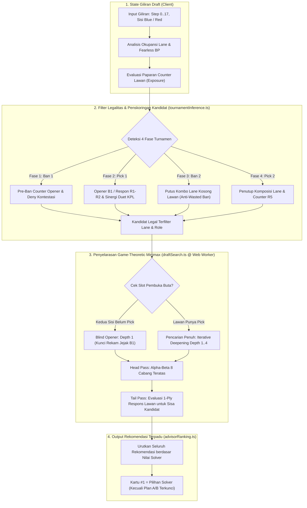
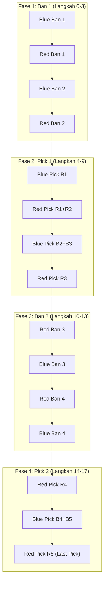

# HoK Draft Engine

Simulator draft, latihan melawan AI, analisis game plan pasca-draft, counter lookup, dan wiki hero **Honor of Kings Global**. Frontend React/TypeScript berjalan pada static hosting; keputusan draft dihitung di browser pengguna.

## Cara kerja mesin draft

Sistem ini dirancang dengan pendekatan **zero-server compute di produksi**, menjalankan kalkulasi taktis deterministik dan pencarian Minimax langsung di browser pengguna.

| Bagian | Peran |
|---|---|
| Aturan & Solver Flex Lane ([draftRules.ts](apps/web/src/engine/draftRules.ts)) | Urutan 18 aksi turnamen / 16 aksi ranked, validasi Fearless/Global, `isOpenerPickSlot`, dan `assignHeroLanes` (primer, flex resmi, flex pro KPL). |
| Mesin Taktis TypeScript ([tournamentInference.ts](apps/web/src/engine/tournamentInference.ts)) | Kekuatan kompetitif Bayesian (KPL 12 bulan), rekam jejak pembuka B1 hierarkis, okupansi lane, matriks counter terarah, dan penyaring kandidat legal. |
| Penyelaras Rekomendasi Solver ([advisorRanking.ts](apps/web/src/engine/advisorRanking.ts)) | Menyelaraskan seluruh rekomendasi UI dengan nilai posisi solver Minimax (Head Alpha-Beta + Tail 1-ply); Pilihan Solver = Kartu #1. |
| Pencarian Minimax Web Worker ([draftSearch.ts](apps/web/src/engine/draftSearch.ts)) | Evaluasi pohon zero-sum `Strength(Kita) - Strength(Musuh)` via Minimax Alpha-Beta (Depth 1..4; batas 1.500 ms lawan / 8.000 ms advisor). |
| Mesin Game Plan Pasca-Draft ([gamePlan.ts](apps/web/src/engine/gamePlan.ts)) | Matchup 5v5 pasca-draft, kurva tempo KPL zero-sum, syarat menang/kalah, rute jungle, dan prioritas gank. |
| Pipeline Audit Bukti Skill ([skill_evidence_audit.py](packages/ml-engine/skill_evidence_audit.py)) | Ekstraksi 29 tag mobilitas, crowd control, dan utilitas dari deskripsi skill resmi secara deterministik lokal. |
| Sinergi Empiris KPL ([extract_kpl_synergy.py](packages/ml-engine/extract_kpl_synergy.py)) | Frekuensi pick/ban, winrate duet, tempo, dan flex lane dari 11.141+ game pro KPL & CN 2019–2026. |

### Diagram Arsitektur Alur Keputusan (Decision Pipeline)



### Format Pertandingan: Turnamen & Ranked

Aplikasi mendukung dua format draft kompetitif yang terintegrasi penuh di mode Simulator maupun Latihan vs AI:

#### 1. Format Turnamen Kompetitif (18 Aksi / 4 Fase)
Format standar turnamen resmi KPL / Global:



#### 2. Format Ranked Match (16 Aksi / 2 Fase)
Format ranked publik Diamond+:
- **Fase 1: Blind Ban Simultan (Langkah 0–5):** Masing-masing tim melakukan 3 ban secara tertutup tanpa mengetahui ban lawan. Kedua tim dapat mem-ban hero yang sama (cross-team overlap diizinkan, tetapi dilarang ban ganda di tim yang sama).
- **Fase 2: Pick Bergiliran (Langkah 6–15):** Urutan pick standar: `B1` $\to$ `R1 + R2` $\to$ `B2 + B3` $\to$ `R3 + R4` $\to$ `B4 + B5` $\to$ `R5`. Hero yang di-ban oleh tim mana pun tidak dapat di-pick.

### Logika Taktis & Matematis Utama

1. **Kekuatan Kompetitif Bayesian Murni:**
   - Popularity band (`popularity_band` S/A/B/C) dan `pick_rate` dari HoK Camp **tidak digunakan sebagai kekuatan** (band S hanya mencerminkan frekuensi pick ladder kasual).
   - Kekuatan dihitung via penyusutan Bayesian (*Bayesian shrinkage*) terhadap data pro KPL 12 bulan terakhir:
     $$kplShrunk = \frac{WR_{KPL} \times N_{matches} + 0.5 \times 40}{N_{matches} + 40}$$
   - Sisa bobot diisi winrate ranked Diamond+ hanya bila sampel KPL belum mencukupi.

2. **Rekam Jejak First-Pick B1 & Pemotongan Kedalaman Pembuka Buta:**
   - Opener dinilai dari efektivitas saat benar-benar di-first-pick di KPL (model hierarkis):
     $$posterior\_B1 = \frac{WR_{B1} \times n_{B1} + WR_{overall\_shrunk} \times 40}{n_{B1} + 40}$$
     $$b1RecordTerm = (posterior\_B1 - WR_{field\_B1}) \times 6.3$$
   - **Pemotongan Kedalaman B1 Buta (`BLIND_OPENER_MAX_DEPTH = 1`):** Saat kedua tim belum memiliki pick (papan kosong), kedalaman Minimax dipotong ke 1 ply agar rekam jejak empiris B1 KPL menjadi penentu utama (menghilangkan bias minimax yang selalu memenangkan Tank tebal akibat proyeksi spekulatif 3-ply).

3. **Filter Anti-Immobile Carry & Aturan Ban:**
   - Hero carry tanpa skill escape (Luban No.7, Hou Yi, Angela, Daji, Milady) dikenakan penalti keras `-2.5` di slot pembuka (B1/R1/R2).
   - Fase Ban 1: Blue mem-ban counter alami opener rencananya (dilarang mem-ban hero yang *sudah di-counter* oleh opener sendiri dengan penalti `-1.30`). Red mem-ban hero kontestasi tinggi milik Blue.
   - Fase Ban 2: Menyisir 2 lane kosong musuh untuk memutus kombo sinergi duet (penalti `-2.40` untuk *wasted ban* di lane yang sudah diisi musuh).

4. **Peredam Paparan Counter Musuh (`evaluateEnemyCounterExposure`):**
   - Bobot sinergi duet diredam jika hero terpapar counter musuh di papan: 1 counter (diredam ke 55%), 2 counter (diredam ke 10%), 3+ counter (ditiadakan / 0%).

5. **Penyelarasan Total Rekomendasi ([advisorRanking.ts](apps/web/src/engine/advisorRanking.ts)):**
   - Seluruh daftar rekomendasi diurutkan oleh nilai posisi solver Minimax (`orderRecommendationsBySolver`), mencapai kesesuaian **80,5%** dengan keputusan AI lawan (dan **100%** di B1 buta). Pilihan solver selalu menjadi Kartu #1 di antarmuka (kecuali pengguna mengunci Plan A/B manual).

## Game Plan Pasca-Draft, Winning Condition & Simulator Swap

Setelah draft selesai, panel Game Plan ([`PostDraftGamePlanPanel.tsx`](apps/web/src/components/PostDraftGamePlanPanel.tsx) & [`gamePlan.ts`](apps/web/src/engine/gamePlan.ts)) menyajikan evaluasi makro 5v5 untuk kedua tim:

1. **Peta Lane & Simulator Swap 5v5 (`00:00–04:00` + Re-Swap `04:00`):**
   - Menugaskan hero ke `Clash`, `Jungle`, `Mid`, `Farm`, `Roam` berbasis lane primer, flex resmi, dan distribusi empiris KPL.
   - Melindungi laner solo via konteks Roam 2v2 dan membatasi swap taktis pra-`04:00` hanya antar-laner (swap non-flex ke Roam/Jungle dicegah agar tidak merusak makro tim).
2. **Kurva Tempo KPL (Zero-Sum) & Winning Condition:**
   - Memakai 132 kurva winrate empiris KPL (fase *Early* `<15m`, *Mid* `15–19m`, *Late* `≥19m`) yang dinormalisasi relatif 100% antar kedua tim.
   - Merangkum arketipe komposisi, syarat menang/kalah kunci, dan checklist item counter ancaman lawan.
3. **Pola Start Jungle, Anti-Invade & Gold-Sharing:**
   - Menentukan kuadran pembuka Jungle (*Strongside* vs *Weakside*), antisipasi invasi Lv 1–2, alokasi gold lane pra-`04:00`, dan prioritas objektif Tyrant/Overlord pada menit `04:00`.

## Simulator dan latihan

- **Simulator:** Mengendalikan kedua tim (format Turnamen atau Ranked) serta mengatur Plan A/B masing-masing.
- **Latihan vs AI:** Bertanding melawan bot AI (pilihan sisi Blue/Red, maksimal 5 game). Format Turnamen mendukung aturan *Fearless BP* (hero yang sudah dipakai terkunci untuk game berikutnya).
- **Mode Bantuan:** Toggle bantuan opsional (rekomendasi, radar taktis, badge peringkat) dapat dimatikan untuk simulasi latihan mandiri.
- **Filter Global:** Membatasi katalog hanya pada hero yang sudah resmi rilis di server Global.

## Live Draft Advisor (membaca layar BP HoK Global)

**Live Draft Advisor** adalah lapisan computer vision in-browser yang membaca layar draft **Ranked** Honor of Kings Global dari jendela Android yang di-mirror via scrcpy, memetakan potret hero ke papan simulator, dan menyarankan pick berikutnya secara instan tanpa ketergantungan server/Python runtime.

> [!NOTE]
> **Read-only, tanpa injeksi input.** Advisor tidak pernah mengirim input ke game (menghindari deteksi otomasi / anti-cheat).

### Cara Menjalankan

1. Mirror perangkat via scrcpy (hindari `--fullscreen` di monitor 16:9 agar tidak letterbox):
   ```powershell
   scrcpy --window-width=1920 --window-height=864 --always-on-top --window-border=less
   ```
2. Jalankan aplikasi web di secure context (`http://localhost:3000`).
3. Buka tab **Draft** → mode **Live Advisor** → **Mulai** → pilih jendela scrcpy.
4. Sesuaikan grid overlay: seret titik anchor hingga kotak preview (garis solid = pick, garis putus-putus = ban) tepat menutupi slot hero di layar.
5. Klik **"Terapkan ke Simulator"** (format simulator harus Ranked) untuk menyinkronkan board terdeteksi ke mesin rekomendasi.

Slot pick membedakan status pra-pilih (*preselected*) dan terkunci (*committed*). Detail teknis matcher NCC/dHash, kalibrasi resolusi, dan batasan aspect ratio didokumentasikan di [`AGENTS.md`](AGENTS.md) (§2.D).

## Sumber dan integritas data

- **Kurohiko:** katalog hero, relasi counter, dan alasan taktis komunitas.
- **HOKFIRE:** statistik, build, arcana, skill, dan referensi matchup.
- **HoKStats:** panduan skill/draft, preset build alternatif, detail item/spell, dan matchup editorial. Data disimpan terpisah dari HOKFIRE/KPL dan tidak otomatis menjadi sinyal ranking sebelum ditinjau.
- **Dataset KPL/CN Pro ([Fire-Phoenixs/kpl-bp-dataset](https://github.com/Fire-Phoenixs/kpl-bp-dataset)):** frekuensi opener, ban, serta sinergi empiris (submodule `data/raw/kpl-bp-dataset`, CC BY-NC 4.0). Data historis CN tidak otomatis mewakili meta Global saat ini.

`hero.counters` berisi hero **yang di-counter oleh hero tersebut**. `hero.countered_by` berisi hero **yang meng-counter hero tersebut**. Arah ini tidak boleh dibalik.

Status rilis ditinjau di `data/mappings/hero_release_status.json`. Hero tanpa status eksplisit belum dapat digunakan. ID 511 tetap menjadi alias tidak aktif untuk **Ata 556**. Hero immobile yang ditandai sebagai opener berisiko tidak masuk rekomendasi B1 atau ban fase pertama.

## Menjalankan aplikasi & setup contributor

Gunakan **Git**, **Node.js 24+**, dan **Python 3.13+** yang dikelola melalui **[`uv`](https://docs.astral.sh/uv/)** (ikuti [`packages/ml-engine/pyproject.toml`](packages/ml-engine/pyproject.toml)).

### Clone & Bootstrap Cepat

Data mentah turnamen berada pada Git submodule [`data/raw/kpl-bp-dataset`](data/raw/kpl-bp-dataset). Untuk contributor penuh maupun frontend-only, lihat panduan lengkap di **[CONTRIBUTING.md](CONTRIBUTING.md)**.

```powershell
# Clone beserta submodule dataset KPL
git clone --recurse-submodules https://github.com/Andndre/hok-draft-engine.git
cd hok-draft-engine

# Atau jika sudah terlanjur clone biasa:
uv run scripts/setup.py --verify

# Contributor UI saja (tanpa perlu Python/uv atau dataset mentah 39.5 MB):
uv run scripts/setup.py --web-only --verify
```

```powershell
cd apps/web
npm.cmd ci
npm.cmd run dev

# Build statis; Vite menyalin isi public secara otomatis
npm.cmd run build
npm.cmd run preview
```

Deploy isi `apps/web/dist/` ke static hosting (atau otomatis ke Hostinger via `.github/workflows/deploy.yml`). Distribusi produksi menyajikan aplikasi statis, dataset versi manifest, dan aset gambar langsung dari origin yang sama (`chunks/` dan `datasets/` immutable). Lihat [`LICENSE`](LICENSE) dan [`NOTICE`](NOTICE) untuk lisensi kode (MIT) serta atribusi dataset turunan KPL (CC BY-NC 4.0).

## Memperbarui hero dan metadata

1. Perbarui sumber hero/statistik/counter dan sinergi di `data/mappings/` melalui pipeline scraper/ekstraktor atau koreksi yang ditinjau.
2. Untuk memperbarui data HoKStats, jalankan importer lokal. Ia membuat coverage report, mencatat sumber/tanggal/patch, dan mengabaikan matchup yang tidak bisa dicocokkan ke katalog hero.

```powershell
cd packages/ml-engine
uv run hokstats_source.py sync

# Tinjau sumber hero, matchup, item, atau spell sebelum dipakai scorer
uv run hokstats_source.py review-guide --hero-id 640 --reviewer "Nama reviewer" --status approved
uv run hokstats_source.py review-matchup --hero-id 640 --relation strong_against --target-id 126 --reviewer "Nama reviewer" --status approved
uv run hokstats_source.py review-catalog --kind item --record-id 1127 --reviewer "Nama reviewer" --status approved

uv run publish_data.py
```

Importer mempertahankan review hanya selama hash sumber cocok. Relasi `strong_against` berarti hero tersebut meng-counter target; `countered_by` berarti hero itu terancam oleh target. Record tanpa bukti tidak dianggap sebagai relasi negatif.

3. Tambahkan atau perbarui status rilis setiap hero pada `hero_release_status.json`. Tinjau kemampuan lane, arah counter, dan mapping Global; pertahankan alias Ata.
4. Bila perlu, audit dan tinjau proposal profil taktis seperti contoh di bawah.
5. Bangun paket data:

```powershell
cd packages/ml-engine
uv run publish_data.py
```

`publish_data.py` menghasilkan manifest schema v2 dan folder `datasets/<versi>/` di `apps/web/public/`. Paket berisi metadata hero, sinergi, status rilis, katalog item, dan katalog spell; semua artefak divalidasi dengan SHA-256 dan disebar secara atomik oleh workflow deploy statis.

Browser memeriksa manifest saat aplikasi dibuka, memvalidasi seluruh artefak, lalu menyimpan satu paket lengkap pada cache IndexedDB `tournament_dataset_v17`. Tidak ada fetch HoKStats atau panggilan API eksternal saat runtime. Jika pembaruan gagal, browser memakai paket valid terakhir atau paket bawaan. Jangan mengedit artefak hasil publikasi secara manual karena checksum akan berubah.

Seri latihan mempertahankan snapshot dataset sampai selesai. Saat memulai seri baru, aplikasi memeriksa pembaruan lagi. Penambahan hero dan perubahan status rilis tidak memerlukan perubahan kode atau whitelist TypeScript.

## Profil taktis dan audit bukti skill lokal

Pipeline taktis memakai **ekstraksi bukti skill deterministik** (`skill_evidence_audit.py` dan `tactical_profiles.py audit-batch`) yang membaca deskripsi skill resmi, role, serta panduan taktis hero secara 100% lokal dan deterministik di komputer pengelola tanpa memerlukan GPU atau layanan eksternal.

### Audit batch hero Global

Untuk mengekstrak bukti skill, mengisi 29 label taktis, dan menghasilkan proposal otomatis untuk 120 hero Global aktif:

```powershell
cd packages/ml-engine

# Audit batch 120 hero Global (auto-approve hero dengan bukti lengkap tanpa ambiguitas)
uv run tactical_profiles.py audit-batch --output-dir ../../data/mappings/tactical_proposals

# Atau audit batch tanpa auto-approve (semua tetap berstatus pending)
uv run tactical_profiles.py audit-batch --output-dir ../../data/mappings/tactical_proposals --no-auto-approve

# Proposal hero tunggal
uv run tactical_profiles.py propose --hero-id 156 --output ../../data/mappings/tactical_proposals/liang.json

# Review manual dan simpan status
uv run tactical_profiles.py review --proposal ../../data/mappings/tactical_proposals/liang.json --reviewer "Nama reviewer" --status approved

# Publikasikan dataset produksi
uv run publish_data.py
```

### Label taktis dan verifikasi bukti

Label mencakup:
- **Mobilitas:** `mobility`, `dash`, `blink`, `leap`, `teleport`
- **Crowd Control:** `suppress`, `cc_taunt`, `cc_knockup`, `cc_knockback`, `cc_pull`, `cc_stun`, `cc_root`, `cc_silence`, `cc_slow`
- **Peran & Utilitas Tim:** `engage`, `disengage`, `frontline`, `peel`, `ally_shield`, `ally_heal`, `ally_move_speed_buff`, `ally_attack_speed_buff`, `ally_damage_buff`, `ally_cleanse`, `ally_cc_immunity`
- **Kerentanan:** `dive_vulnerable`, `kite_vulnerable`, `low_damage`, `weak_early`

Auditor menyaring kata negasi (seperti pasif Yaria yang mengecualikan suppress agar tidak ditandai sebagai `suppress=ya`) dan kontaminasi teks hero antar-sumber. Nilai yang tidak didukung bukti skill resmi tetap `tidak_diketahui`.

Proposal menyimpan sumber resmi, hash konten, dan status review. Publisher hanya menyertakan profil berstatus `approved` dengan SHA-256 hash sumber yang valid; perubahan pada data sumber hero otomatis membatalkan approval lama agar ditinjau ulang. Hero tanpa profil taktis approved tetap menggunakan fallback heuristik role bawaan.

**Fixture offline:** pengujian tanpa evaluasi live dapat memakai `--response-fixture <file.json>` atau `--response-fixtures-dir <dir>` untuk menguji alur pipeline.

## Pengujian dan benchmark

```powershell
cd apps/web
npm.cmd test
npm.cmd run benchmark
npm.cmd run build
```

Pengujian mencakup validasi Global/Fearless, lima game tanpa pengulangan pick per tim, matching lane flex, arah counter Liang, alias Ata, batas waktu pencarian, worker aktual melalui transport Node, pembatalan, hasil kedaluwarsa, kedua sisi pemain, pembaruan/cache paket data, serta suite pasca-draft ([gamePlan.test.mjs](apps/web/tests/gamePlan.test.mjs) dan SSR [ui.test.mjs](apps/web/tests/ui.test.mjs): normalisasi kurva tempo 100%, konteks Roam 2v2, penolakan swap non-flex ke Roam/Jungle, dan rencana anti-invade jungle).

```powershell
cd packages/ml-engine
uv run python -m unittest test_data_pipeline.py test_skill_evidence_audit.py test_hokstats_source.py
uv run export_draft_benchmark.py --cutoff 2024-01-01 --limit 24

cd ../../apps/web
npm.cmd run benchmark -- --historical ../../data/processed/draft_benchmark.json --limit 24 --output ../../data/processed/draft_benchmark_results.json
```

Benchmark membandingkan baseline dengan pencarian pada fixture taktis dan posisi KPL yang dipisahkan berdasarkan tanggal. Statistik KPL untuk benchmark dihitung hanya dari pertandingan sebelum cutoff. Pilihan historis bukan satu-satunya keputusan yang benar; angka agreement bukan estimasi kekuatan atau win rate AI. Metadata role dan statistik publik masih memakai snapshot saat ini, sehingga evaluasi ini bukan backtest meta historis yang lengkap.

Data lokal KPL 2025–2026 memakai 20 aksi. Exporter menyaring pertandingan yang cocok dengan format aplikasi 18 aksi dan roster Global; cutoff default 2024 menyediakan holdout kompatibel. Benchmark tidak mengubah aturan aplikasi menjadi 20 aksi.

### Pengujian harness vision (offline)

Harness evaluasi offline untuk computer vision (`evaluate-vision-corpus.mjs`) menggunakan corpus frame ground-truth lokal yang di-gitignore (`data/vision-corpus/`). Dokumentasi lengkap perintah kalibrasi dan metrik akurasi internal didokumentasikan di [`data/vision-corpus/README.md`](data/vision-corpus/README.md) dan [`AGENTS.md`](AGENTS.md) (§2.D).

Panduan agen berada di [AGENTS.md](AGENTS.md). Navigasi arsitektur dapat dimulai dari [knowledge graph](graphify-out/graph.html). Jalankan `graphify update .` setelah mengubah sumber TypeScript/Python.
